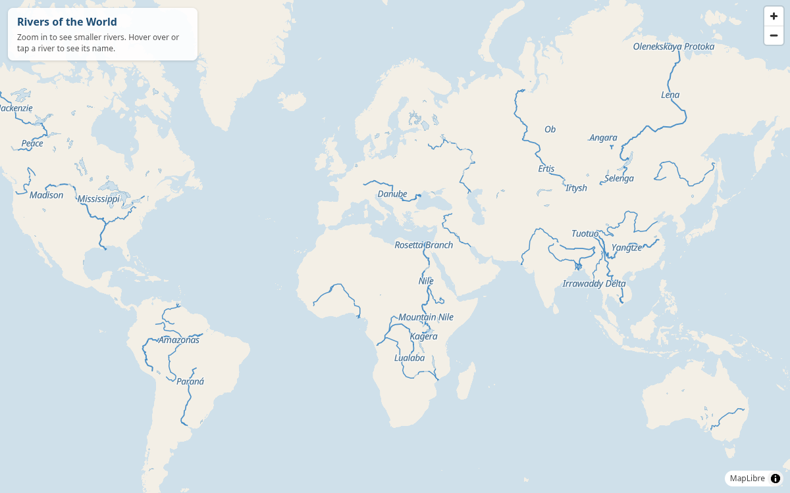
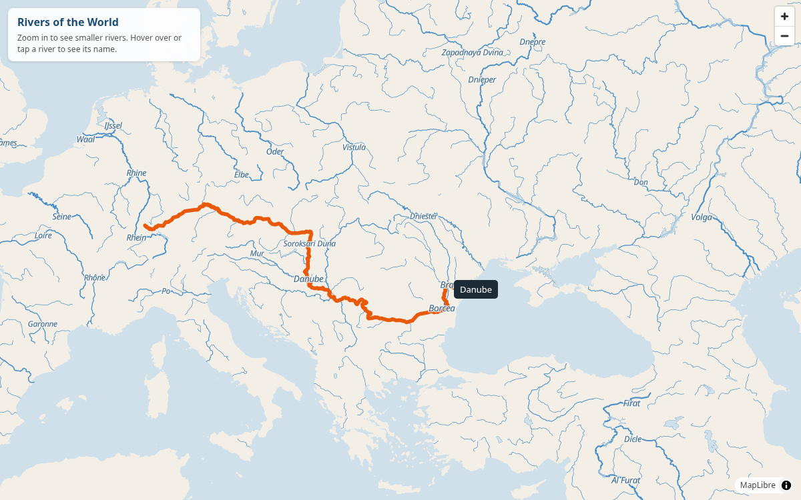
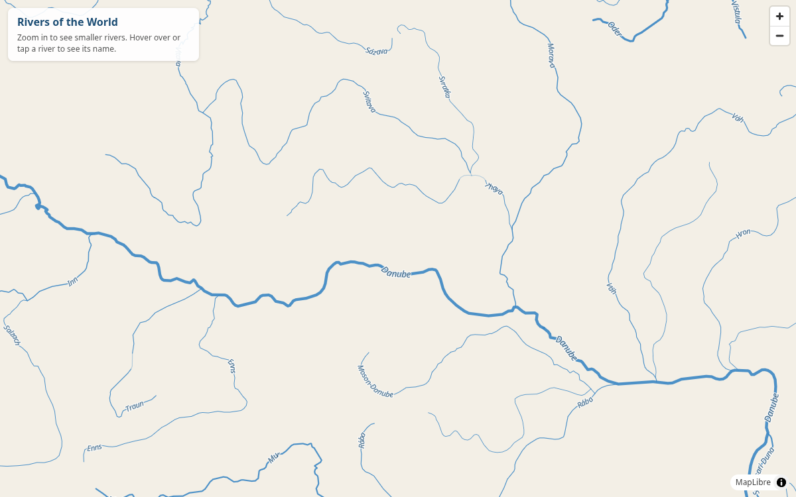
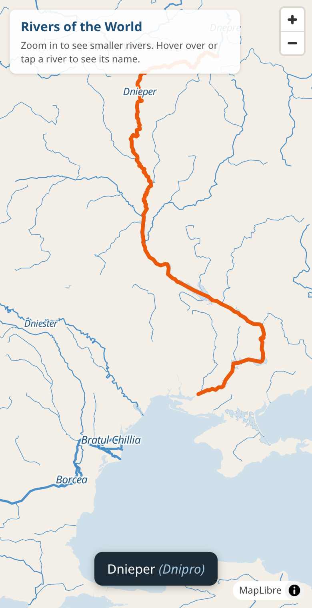

# Rivers of the World

I always want to know where the most important rivers are, and I often pay
attention to their names when they're mentioned, but Google Maps makes it so
hard to visualize them.

So this is a map with just rivers on it. Zoomed out, you see the big ones,
like the Amazon, the Nile, the Danube and the Mississippi. Zoom in and smaller
rivers appear. Hover over or tap any river to light it up from source to mouth
and see its name.



Hovering over the Danube highlights the whole river:



Zooming in shows smaller rivers, with names along their course:



On a phone, tap a river to see its name:



## Run it locally

```sh
python3 -m http.server 8000 --directory public
```

Then open http://localhost:8000.

River data comes from [Natural Earth](https://www.naturalearthdata.com/).
